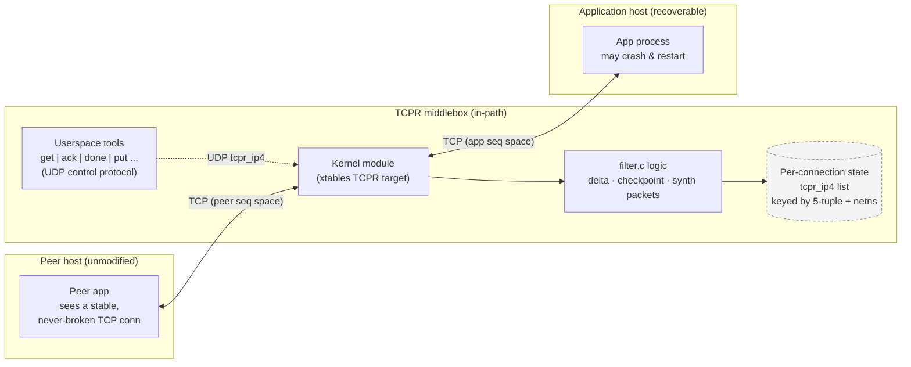
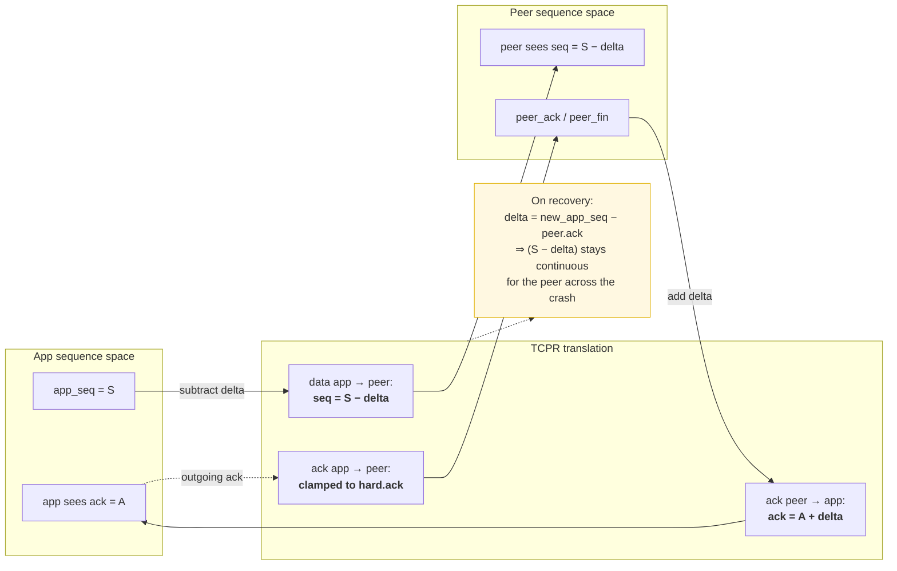
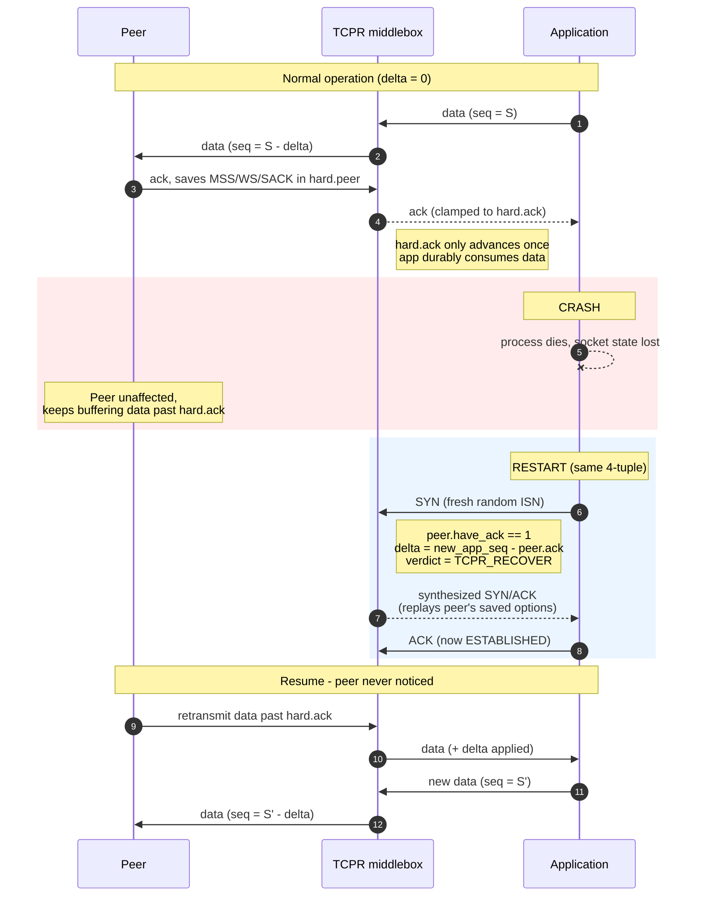
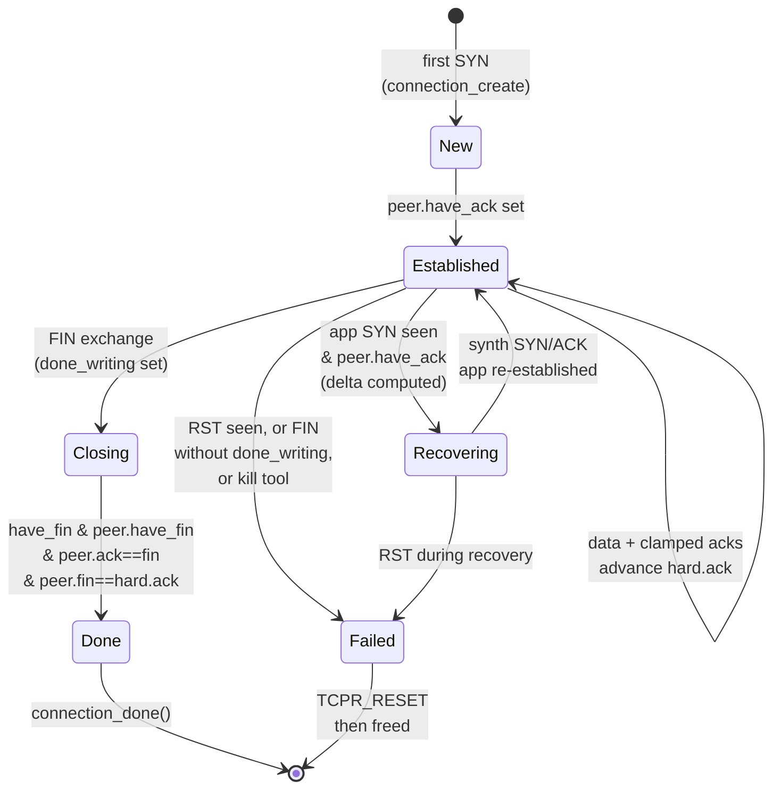
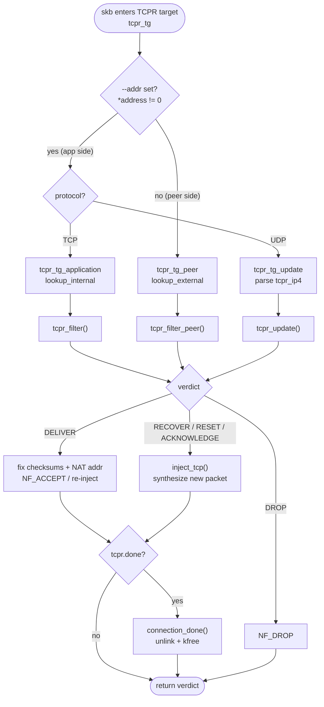
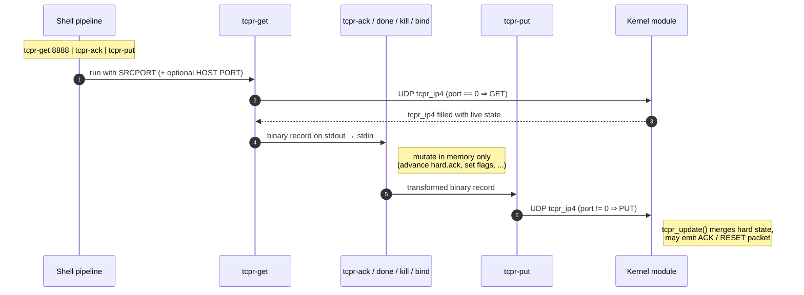

# TCPR — TCP Recovery

> [!abstract] One-sentence summary
> TCPR keeps a long-lived TCP connection alive while **one endpoint's application process crashes and restarts**, without the *peer* ever noticing or needing any modification. It does this with a tiny crash-survivable checkpoint + a sequence-number `delta` + a middlebox that fabricates handshake/ack/reset packets.

## Table of Contents
- [[#The Big Picture]]
- [[#Code Layout]]
- [[#1. The Recovery Mechanism (the core trick)]]
- [[#2. Connection Teardown — fin, checkpoint, and done]]
- [[#3. Kernel Dispatch Path]]
- [[#4. Userspace Control Protocol & Demo]]
- [[#5. Ideal Use Cases]]
- [[#6. Known Bugs / Rough Edges]]
- [[#Glossary]]

---

## The Big Picture

Normally, if a server process dies, the kernel's TCP state is lost and the connection breaks (RST). TCPR puts a small "proxy" on a separate box (a gateway/bridge/middlebox) that keeps just enough extra state so that after the application restarts, the connection can be silently re-established with the peer none the wiser.

```
  peer  <------ TCP ------>  [ TCPR middlebox ]  <------ TCP ------>  application
                             (kernel module +                        (the recoverable
                              userspace tools)                         endpoint)
```

### Architecture



TCPR sits in the network path. It rewrites sequence numbers, ports, and addresses in both directions, and remembers what the application has durably acknowledged. When the app crashes and comes back, TCPR fabricates a SYN/ACK handshake with the restarted app, replays the right numbers, and the peer's connection continues uninterrupted.

> [!tip] The key idea in one sentence
> TCPR keeps a **"hard" checkpoint** of how far the peer's data has been acknowledged plus the peer's handshake options, and maintains a **sequence-number `delta`** between the app's pre-crash and post-crash connections — so when the app restarts, TCPR can replay a handshake and seamlessly splice the new app-side connection onto the peer's still-open connection.

---

## Code Layout

### `include/tcpr/` — shared headers (kernel + userspace via `#ifdef __KERNEL__`)

- **`types.h`** — core state structures:
  - `struct tcpr_hard` — the **"hard"** state that must survive a crash (ports, peer's MSS/window-scale/SACK options, the checkpointed ACK, done-reading/writing flags).
  - `struct tcpr` — full per-connection state: sequence `delta`, current ack/seq/fin/window, peer's ack/fin/window, status flags (`done`, `failed`, `syn_sent`).
  - `struct tcpr_ip4` — adds IPv4 addresses on top of `tcpr`; this is the unit exchanged with userspace tools.
- **`filter.h`** — the filtering API and the verdict enum (`DROP`, `DELIVER`, `ACKNOWLEDGE`, `RECOVER`, `RESET`).
- **`util.h`** — userspace helper prototypes.

### `module/` — kernel side (an iptables/xtables target called `TCPR`)

- **`filter.c`** — the **heart of the algorithm**, pure logic (compiles in kernel and userspace):
  - `tcpr_filter()` — packets from the **application** → peer.
  - `tcpr_filter_peer()` — packets from the **peer** → application.
  - `tcpr_update()` — merge externally-supplied state into a connection.
  - `tcpr_acknowledge()` / `tcpr_recover()` / `tcpr_reset()` — **synthesize** TCP packets.
  - `shorten()` — incremental one's-complement checksum fixups.
- **`module.c`** — Linux kernel glue. Registers an xtables target on `LOCAL_IN`/`LOCAL_OUT`, keeps a linked list of `connection` structs keyed by 5-tuple + network namespace, dispatches packets.
- **`libxt_TCPR.c`** — userspace iptables plugin so you can write `iptables ... -j TCPR --addr 192.0.2.1`.

### `src/` — userspace command-line tools (Unix filters over binary `tcpr_ip4` records)

| Tool | Role |
|------|------|
| `get SRCPORT [HOST PORT]` | fetch state from module → stdout |
| `put` | stdin → write state to module |
| `print` | pretty-print records (human readable) |
| `ack [N]` | advance `hard.ack` by N bytes (or all) |
| `done [rw]` | set done_reading/writing, or force `done` |
| `bind HOST PORT` | set the app's internal address/port |
| `kill` | set `failed = 1` |
| `util.c` | shared helpers (`resolve_address`, `connect_to_tcpr`, `get_tcpr_state`) |
| `chat.c`, `bridge.c`, `benchmark.c` | larger demo/test apps (`tcpr-chat` used in examples) |

### `examples/` — shell scripts using Linux network namespaces + a bridge
- `recover/` — simplest demo: failure and in-place recovery.
- `migrate/` — advanced demo: live migration to a replica.

### Build system
GNU autotools (`configure.ac`, `Makefile.am`) build the userspace tools and the xtables library; the kernel module is built separately with the kernel build system (`module/Makefile`).

---

## 1. The Recovery Mechanism (the core trick)

### The central problem
A TCP connection is identified by `(src IP, src port, dst IP, dst port)` and kept alive by two monotonically increasing sequence spaces. When the app crashes:
- The **peer** still thinks the connection is alive and keeps its sequence numbers.
- The **restarted app** opens a *brand new* socket with a random, unrelated ISN.

Letting the new SYN through would make the peer reject it (RST). TCPR must **bridge the two sequence-number spaces** so neither side notices.

### 1.1 The `delta`
`delta` is the offset between the application's sequence space and the peer's sequence space (app → peer). In normal operation `delta = 0`. Every app→peer packet is rewritten in `tcpr_filter`:

```c
// filter.c:101-103
check += shorten(~h->seq);
h->seq = htonl(ntohl(h->seq) - t->delta);   // subtract delta
check += shorten(h->seq);
```

The peer only ever sees `app_seq - delta`. Acks returning from the peer get `delta` **added** so the app sees them in its own space:

```c
// filter.c:193-195 (tcpr_filter_peer)
h->ack_seq = htonl(ntohl(h->ack_seq) + t->delta);
```

So the whole scheme reduces to: **when the app restarts, compute the `delta` that lines the new connection up with where the peer is, then fix up every packet from then on.**



### 1.2 Detecting a restart & computing `delta`
A restarted app sends a fresh **SYN** (`ack=0`). That's the trigger:

```c
// filter.c:62-78
if (!h->ack) {                  // SYN (no ACK bit)
    t->syn_sent = 1;
    if (t->peer.have_ack) {     // we already have an ESTABLISHED peer
        t->delta = ntohl(t->seq) - ntohl(t->peer.ack);  // <-- THE delta
        t->hard.done_writing = 0;
        t->have_fin = 0;
        return TCPR_RECOVER;    // RECOVERY, not a fresh connection
    } else {                    // brand-new connection, first time
        t->port = h->source;
        if (!t->hard.port) t->hard.port = h->source;
        t->hard.peer.port = h->dest;
        if (h->check) h->check = ~shorten(shorten(check));
        return TCPR_DELIVER;    // pass SYN through normally
    }
}
```

- `peer.have_ack == 0` → genuine first-time connection → `TCPR_DELIVER`.
- `peer.have_ack == 1` → a live peer that's been acking → a new SYN can only mean **crash + restart** → recovery.

`delta = new_app_seq − peer_expected_seq`, so afterwards `new_app_seq − delta == peer_expected_seq`. The peer never sees a gap.

### 1.3 Synthesizing the handshake — `tcpr_recover`
The new app waits for a SYN/ACK the real peer won't send, so TCPR fabricates it:

```c
// filter.c:246-282 (abridged)
void tcpr_recover(struct tcphdr *h, struct tcpr *t) {
    memset(h, 0, sizeof(*h));
    h->source  = t->hard.peer.port;              // pretend from the peer
    h->dest    = t->port;                         // to the app
    h->seq     = htonl(ntohl(t->hard.ack) - 1);   // peer's seq, -1 for SYN
    h->ack_seq = t->seq;                          // ack app's new ISN+1
    h->syn = 1; h->ack = 1; h->window = t->peer.win;
    // Replay the peer's ORIGINAL handshake options (saved in hard.peer):
    //   MSS, window scale, SACK-permitted
}
```

> [!important] Why options are saved
> `tcpr_filter_peer` recorded the peer's MSS/WS/SACK during the original handshake into `hard.peer` (crash-survivable). On recovery they're replayed so the restarted app negotiates an identical connection — otherwise the sequence arithmetic would corrupt.

### 1.4 How the kernel emits these packets
`filter.c` only fills in a `tcphdr`; `module.c` wraps it in IP and sends it:

```c
// module.c:174-220 (inject_tcp, abridged)
case TCPR_RECOVER:
    tcpr_recover(&packet.tcp, &c->state.tcpr);
    packet.ip.saddr = c->state.peer_address;  // looks like it's from the peer
    packet.ip.daddr = c->state.address;        // to the application
```

```c
// module.c:337-344 (dispatch)
tcpr_verdict = tcpr_filter(&c->state.tcpr, tcp, ...);
if (tcpr_verdict == TCPR_DELIVER) {
    fix_checksums(ip, tcp, ip->saddr, c->address);
    ip->saddr = c->address; verdict = NF_ACCEPT;   // mutate in place
} else if (tcpr_verdict != TCPR_DROP) {
    inject_tcp(c, tcpr_verdict, skb);              // RECOVER/RESET/ACKNOWLEDGE
}
```

- `TCPR_DELIVER` → mutate the real packet and `NF_ACCEPT`.
- `TCPR_RECOVER`/`RESET`/`ACKNOWLEDGE` → drop original, inject a synthesized packet.

### 1.5 The crash-surviving checkpoint — `hard.ack`
```c
struct tcpr_hard {
    uint16_t port;
    struct { uint16_t port, mss; uint8_t ws, sack_permitted; } peer;
    uint32_t ack;                 // CHECKPOINT: next byte expected from peer
    uint8_t done_reading, done_writing;
};
```

`hard.ack` may only advance once the app has **durably consumed** the peer's data. Otherwise, after a crash, recovery would tell the peer "I already got X..Y" that the app never processed → data lost.

TCPR clamps the app's outgoing acks to `hard.ack`:

```c
// filter.c:93-99
} else if (h->ack_seq != t->hard.ack) {
    if (size == (size_t)h->doff * 4) return TCPR_DROP;   // pure ack → suppress
    h->ack_seq = t->hard.ack;                            // clamp ack to checkpoint
}
```

The peer is told "I've got up to `hard.ack`" and no further, so it **retains** anything past the checkpoint and **retransmits** after recovery → the no-data-loss invariant.

### Full recovery sequence
1. **Normal:** `delta = 0`; filters pass packets, clamp acks to `hard.ack`, save peer options.
2. **Crash:** app dies; peer keeps buffering unacked data.
3. **Restart:** app sends fresh SYN.
4. **Detection:** `tcpr_filter` sees SYN + `peer.have_ack` → computes `delta` → `TCPR_RECOVER`.
5. **Fabricated handshake:** `tcpr_recover` builds SYN/ACK; module injects it; app reaches ESTABLISHED.
6. **Resume:** peer retransmits past `hard.ack`; `delta` translates everything. Neither stack learns a crash happened.



---

## 2. Connection Teardown — fin, checkpoint, and done

Relevant state:
```c
uint32_t fin;        // seq of OUR fin (app→peer), in peer space
uint8_t  have_fin;
struct { uint32_t ack, fin; uint16_t win; uint8_t have_fin, have_ack; } peer;
uint8_t done;        // fully closed, safe to free
```

### App sends a FIN
```c
// filter.c:55-60
if (h->fin) {
    t->fin = htonl(ntohl(t->seq) + 1 - t->delta);  // our FIN seq, in peer space
    t->have_fin = 1;
    if (!t->hard.done_writing) t->failed = 1;       // FIN without being "done writing" = failure
}
```

### Peer sends a FIN
```c
// filter.c:174-177
if (h->fin) {
    t->peer.fin = htonl(ntohl(h->seq) + (h->syn?1:0) + 1 + size - h->doff*4);
    t->peer.have_fin = 1;
}
```

### The `done` condition (appears in 3 places)
```c
// filter.c:90-92 (and 183, and 231-233)
if (t->have_fin && t->peer.have_fin && t->peer.have_ack
    && t->peer.ack == t->fin        // peer acked OUR fin
    && t->peer.fin == t->hard.ack)  // we acked (to checkpoint) the PEER's fin
    t->done = 1;
```

> [!note] Why `hard.ack` (not live `ack`)
> `done` can't be set until the app has **durably** processed everything — same no-data-loss invariant. `tcpr_acknowledge` recomputes `done` after advancing `hard.ack`, since that may be the final event completing the close.

### What `done` triggers
```c
// module.c:345-349 (and 406-410, 296-297)
if (c->state.tcpr.done) { connection_done(c); }  // unlink + kfree
```

Orderly shutdown: tell TCPR "done writing" (so its FIN is clean, not failure) → FIN exchange completes → `done` flips once both sides' data is fully acked **and** checkpointed.

### Connection lifecycle



---

## 3. Kernel Dispatch Path

### Entry point
```c
// module.c:415-434
static unsigned int tcpr_tg(struct sk_buff *skb, const struct xt_action_param *par) {
    const uint32_t *address = par->targinfo;      // the --addr value, or 0
    struct net *net_ns = dev_net(skb->dev);
    if (!net_ns) net_ns = current->nsproxy->net_ns;
    if (!skb_try_make_writable(skb, skb->len)) return NF_DROP;
    if (*address) return tcpr_tg_application(skb, *address, net_ns);  // app side
    else          return tcpr_tg_peer(skb, net_ns);                   // peer side
}
```

The **`--addr` argument is the switch** (see `setup-tcpr`): the app-direction rule carries `--addr 192.0.2.1`; the peer-direction rule has none (`*address == 0`). The app rule matches **TCP and UDP** (UDP = the control protocol).

### Connection identity
Keyed by 5-tuple **plus network namespace**. Two lookups because a connection has two faces:
- `lookup_internal(...)` — matches on the app's **real** internal address/port.
- `lookup_external(...)` — matches on the **translated/stable** address/port the peer sees.

TCPR is doing NAT-like translation, so the same connection is found by different keys per direction.

### Three paths
1. **App → peer** (`tcpr_tg_application`): non-TCP → `tcpr_tg_update`; else `lookup_internal`, create on first SYN, run `tcpr_filter`, SNAT `ip->saddr` → stable addr on DELIVER.
2. **Peer → app** (`tcpr_tg_peer`): `lookup_external`; a `lookup_external(0, 0, ...)` template entry implements **listening sockets** (peer-initiated connections); run `tcpr_filter_peer`, DNAT `ip->daddr` → app's real addr, **re-inject via `inject_ip`** (always returns NF_DROP for original).
3. **Control** (`tcpr_tg_update`): UDP payload is a `tcpr_ip4`; find/create connection, run `tcpr_update`, reply with state or inject synthesized TCP.



---

## 4. Userspace Control Protocol & Demo

### Wire protocol — `tcpr_ip4` over UDP, request/reply
```c
// util.c connect_to_tcpr(): TCPR_HOST / TCPR_PORT env vars, SOCK_DGRAM
// util.c get_tcpr_state(): fill identifying fields, send, recv full state
```

```c
// filter.c:204-211 tcpr_update()
if (!u->port) {                  // empty port → it's a GET
    memcpy(u, t, sizeof(*u));     // return current state
    return TCPR_DELIVER;
}
// otherwise PUT: merge caller's hard state in
memcpy(&t->hard, &u->hard, sizeof(t->hard));
t->port = u->port; t->done = u->done; t->failed = u->failed;
```

### Tools compose with pipes (binary `tcpr_ip4` records)
```sh
tcpr-get 8888 | tcpr-print               # inspect a connection
tcpr-get 8888 | tcpr-ack | tcpr-put      # checkpoint all received data
tcpr-get 8888 | tcpr-kill | tcpr-put     # force a reset
tcpr-get 8888 | tcpr-done w | tcpr-put   # mark done writing before clean close
```

The `get | transform | put` pattern is the whole management model. `print` taps anywhere for debugging.



### The demo (`examples/recover`)
```sh
# ./setup-network      # netns for peer + app, a bridge between them
# ./setup-tcpr         # modprobe tcpr; install iptables TCPR rules
                       # ./peer          (start the other endpoint)
# ./application        # start tcpr-chat in the app netns
    ... type back and forth ...   # normal TCP, delta = 0
^C                                 # KILL the app → simulated crash
# ./recover            # restart tcpr-chat with the SAME addrs
    ... more typing ...            # connection resumes! peer never noticed
^D                ^D               # clean close from both ends
# ./teardown-tcpr
# ./teardown-network
```

`application`/`recover` run the same command:
```sh
ip netns exec application tcpr-chat -b 192.0.2.1:8888 -c 192.0.2.2:9999 -t 192.0.2.2:7777 -v
# -b bind  -c connect-to-peer  -t TCPR control endpoint  -v verbose
```
Because `recover` reuses the identical 4-tuple, the new SYN hits the **existing** connection entry (`peer.have_ack` set) → `delta` computed → `TCPR_RECOVER` → fabricated SYN/ACK → session continues.

---

## 5. Ideal Use Cases

> [!success] Fits when all three hold
> 1. The connection is **long-lived** (reconnection cost matters).
> 2. You **can't change the peer** (or don't want to).
> 3. The recovering app can **rebuild its application state** from somewhere (TCPR recovers the *wire* connection, not your app's memory).

**Good fits**
1. **Transparent server failover/restart** — thousands of unmodified clients (browsers, appliances, IoT) stay connected across a crash/deploy.
2. **Long-lived, hard-to-reestablish connections** — DB replication, message brokers, log shippers, market-data feeds, streaming/telemetry, anything behind an expensive handshake (TLS/auth).
3. **Zero-downtime maintenance/upgrades** — restart/patch the app while connections ride through; extends to **live migration to a replica** (`examples/migrate`).
4. **Replicated / BFT services** (its research origin) — small externalizable stable state lets a replica take over a connection.
5. **Protecting unmodifiable or legacy clients** — peer needs no library/kernel/awareness.

> [!failure] Wrong tool when
> - You control **both** endpoints → use app-level reconnect, QUIC, or a resumable protocol.
> - **Short-lived** connections (typical HTTP) → just reconnect.
> - You expect **app memory** to be recovered automatically → TCPR does not checkpoint app state.
> - The checkpoint can't keep up / correctness is subtle → advancing `hard.ack` too early loses data, too late costs latency/memory.
> - **Modern encrypted transports** → QUIC is UDP; TCPR is a plain-TCP header-rewrite mechanism.

### Deployment reality check
- Needs an in-path **middlebox** running a custom kernel module + iptables target.
- That box holds the crash-survivable state → must itself be reliable (replicate/HA it).
- Per-packet rewrite cost + operational complexity, tied to Linux netfilter/xtables internals.

> [!quote] Honest framing
> TCPR is a clever **research system** for *transparent* TCP connection recovery. In 2026, if you're greenfield and control both ends, **QUIC connection migration** or an app-level resumable protocol solves much of the same problem more cleanly. TCPR's enduring niche is exactly what those can't touch — **unmodifiable peers and legacy TCP services that must survive endpoint failure.**

---

## 6. Known Bugs / Rough Edges

> [!warning] Latent issues spotted in the code
> - **`inject_ip` (module.c:136-153):** uses `skb` (`skb_reserve`) and `dev_net(oldskb->dev)` **before** `skb = alloc_skb(...)`. Lines 139-140 run against an uninitialized `skb`; duplicated `skb_reserve` looks like a bad patch/merge artifact. Correct order: compute `net`, `alloc_skb`, then `skb_reserve`.
> - **Use-after-free race:** `connection_done` frees the `connection` while code still holds `c->tcpr_lock`, which lives *inside* the freed struct (`/* XXX race */` comments at module.c:301, 350, 411).
> - **Peer path never uses `NF_ACCEPT`:** `tcpr_tg_peer` relies on drop-original + `inject_ip` copy; the default `verdict = NF_DROP` is never overwritten.
> - **Kernel-API churn:** hand-patched "Fix" comments around `ip_local_out` and namespace handling indicate sensitivity to kernel version.

---

## Glossary

- **`delta`** — offset between the app's and peer's sequence spaces; recomputed on recovery; `0` in normal operation.
- **`hard` state (`tcpr_hard`)** — the crash-survivable checkpoint: ports, peer options, `hard.ack`, done flags.
- **`hard.ack`** — the checkpointed "next byte expected from peer"; only advances once data is durably consumed; bounds what the peer may discard.
- **Verdicts** — `DROP`, `DELIVER`, `ACKNOWLEDGE`, `RECOVER`, `RESET` (see `filter.h`).
- **Internal vs external lookup** — same connection found by the app's real addr/port vs the peer-visible stable addr/port (NAT-like translation).
- **Control protocol** — `tcpr_ip4` over UDP; `get`/`put` read/merge state; tools compose as Unix filters.

---

## See Also
- Project home: `http://www.cs.cornell.edu/~burgess/tcpr/`
- `README` — build + demo walkthrough
- `examples/recover/` — in-place failure & recovery demo
- `examples/migrate/` — live migration to a replica demo
